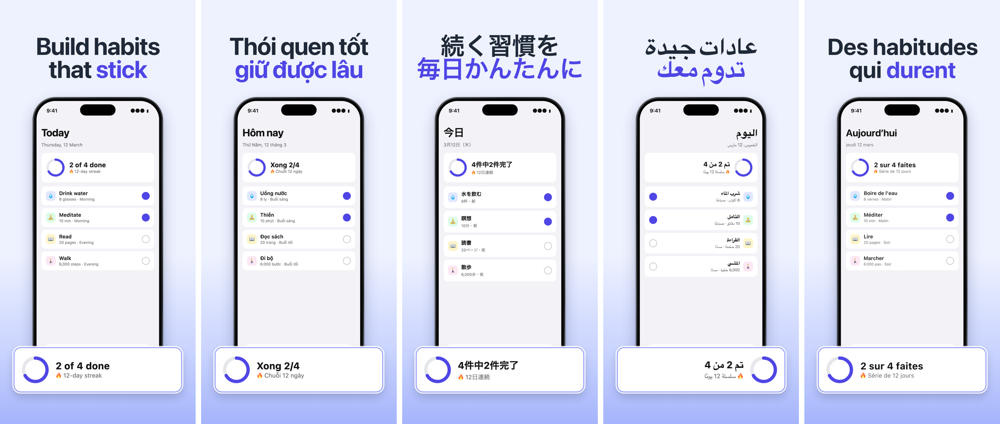

# App screenshots in every language

**Your App Store screenshots in every language — made and localized by Claude Code.**

Two skills for [Claude Code](https://claude.com/claude-code):

| Skill | What it does |
|---|---|
| `make-app-screenshots` | Builds new App Store screenshots (iPhone 6.9", 1290×2796) from **real captures of your app in the iOS Simulator**: gradient background, two-colour headline, device frame, a card lifted out of the UI. Learns the look from your existing screenshots, or asks for your colours. Then renders every language your app supports. |
| `localize-app-screenshots` | Translates the **text** of screenshots you already have (from Figma, a designer, anywhere) into other languages while keeping every other pixel: erases each string, redraws the translation with the same font size, colour and baseline, resizes pills and tags, keeps two-colour headlines. CJK, Arabic (right-to-left) and Hindi included. |

Both pull UI strings from your app's own String Catalogs (`.xcstrings`), so the words in the
screenshots match the words in the app.



## Install

In Claude Code:

```
/plugin marketplace add huypham85/app-screenshots-in-every-language
/plugin install app-screenshots-in-every-language@huypham85
```

Then just ask, in your app's repo:

- "Make an App Store screenshot for our new widget feature"
- "Localize my screenshots in `appshots/source` into German, Japanese and Arabic"
- "Add a 5-star reviews laurel to the first screenshot"

## Requirements

- macOS with Xcode and an iOS Simulator (for captures)
- Python 3 — the skills create their own virtualenv (`~/.cache/app-screenshots-in-every-language/venv`)
- Google Chrome (renders the HTML frames)
- Optional: [SF Pro](https://developer.apple.com/fonts/) for the exact iOS look (Inter is bundled as a fallback);
  `brew install fribidi` for Arabic and Hindi

## How it works

```
compose:   simulator capture ─► HTML/CSS frame (brand.json) ─► headless Chrome ─► PNG ─► every locale
localize:  flat PNG + layout.json (where each text is) + strings/<locale>.json ─► erase + redraw ─► PNG
```

Your files live in your repo under `appshots/` (`brand.json`, `compose/`, `layouts/`, `strings/`,
`source/`; `out/` is generated). Everything is plain JSON and HTML, so you can tweak anything.
See [`references/`](references) for the formats and [`examples/demo`](examples/demo) for a
complete example (a fictional habit tracker, English → Vietnamese, Japanese, Arabic, German).

## Limits (v0.1)

- iPhone 6.9" only (no iPad, no Google Play yet).
- Localize changes text only: it does not mirror layouts for right-to-left languages.
- Capturing app states may need a small DEBUG-only loader in your app for repeatable data — the
  compose skill offers to write one, only with your OK.
- You are responsible for following Apple's guidelines; [`references/apple-rules.md`](references/apple-rules.md)
  lists the ones these frames touch (Apple icons and badges, Siri UI, ratings). Not legal advice.

## Author

Made by **Huy Pham** — [@huyphamm85 on X](https://x.com/huyphamm85) · [GitHub](https://github.com/huypham85).
It grew out of shipping the App Store screenshots of [Doz](https://getdoz.app), a medication
reminder for iOS, in 13 languages.

Issues and pull requests welcome.

## License

[MIT](LICENSE) © 2026 Huy Pham. Bundled Inter fonts: SIL Open Font License 1.1.
Not affiliated with Apple. App Store, iPhone, Siri and SF Pro are trademarks of Apple Inc.
